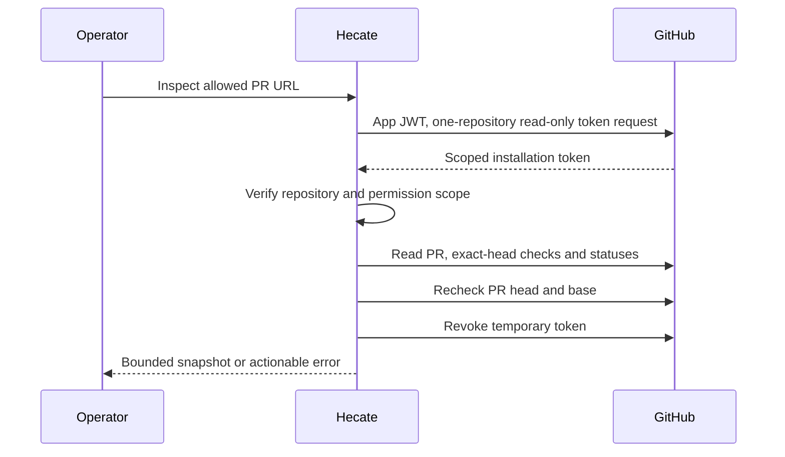

# GitHub App connection

Hecate can inspect a GitHub pull request and its reported checks from
**Connections → GitHub**. The runtime uses an operator-configured GitHub App;
opening Connections reads local configuration only. Inspection is an explicit
network action and does not invoke an agent or charge a model provider.

## Set up the runtime

1. Register a GitHub App with repository permissions **Checks: read**,
   **Commit statuses: read**, and **Pull requests: read**. GitHub includes
   **Metadata: read**. Webhooks are not needed for this inspection feature.
2. Install it on selected repositories. Keep its private key outside agent
   workspaces, readable only by the runtime operator. Never paste it into chat.
3. Configure the runtime and restart it:

   ```dotenv
   HECATE_GITHUB_APP_CLIENT_ID=your-app-client-id
   HECATE_GITHUB_APP_INSTALLATION_ID=your-installation-number
   HECATE_GITHUB_APP_PRIVATE_KEY_FILE=/host/secrets/github-app.pem
   HECATE_GITHUB_REPOSITORIES=owner/repository,owner/another-repository
   ```

All four settings are required together. The allowlist accepts exact
`owner/repository` names, not URLs or wildcards. The private key must be an
unencrypted RSA PEM key (PKCS#1 or PKCS#8), 2048–8192 bits, at most 64 KiB,
at an absolute path to a regular file (not a symlink or special file).
GitHub Enterprise Server is not supported by this first connection contract.
The same configuration works in local and hosted runtimes; hosted operators
must mount the secret into their isolated runtime, not the browser client.

**Configured** is not a successful authentication claim. The runtime reads the
key and verifies repository access only when you press **Inspect pull request**.

## What inspection means

Enter a URL such as `https://github.com/owner/repository/pull/123` without query
parameters or a fragment. Hecate requests a short-lived token restricted to
that one repository and read-only permissions, verifies the returned scope,
and reads the PR's head commit, check runs, and commit statuses. It rechecks
the PR head and base before returning, so a concurrent push requires a refresh.

The panel shows at most 100 check runs and 100 commit statuses. Larger sets are
explicitly **incomplete**, never passed. No reported checks is a separate state
from success. Results are a point-in-time snapshot, not proof that required
checks exist, branch protection is satisfied, or merging is allowed.

Inspections have a 30-second overall deadline, bounded responses, and two
concurrent slots. The runtime attempts to revoke each token when inspection
settles; if that cleanup fails, GitHub's expiry remains the backstop. Tokens,
private keys, and raw upstream error bodies never enter API results, agent
prompts, tool environments, or Hecate persistence. Inspection results remain in
the open UI component only, not browser storage. Existing HTTP access tracing
still applies; this is not a no-metadata network mode.

This connection does **not** yet attach a PR to a Task, monitor CI, read job
logs, launch repairs, publish commits, rerun checks, or merge. Those require
separate explicit execution and retry contracts. A passing panel must not be
used to bypass independent review or repository protection.



See GitHub's [App authentication guide](https://docs.github.com/en/apps/creating-github-apps/authenticating-with-a-github-app/generating-an-installation-access-token-for-a-github-app)
for installation and token details.
